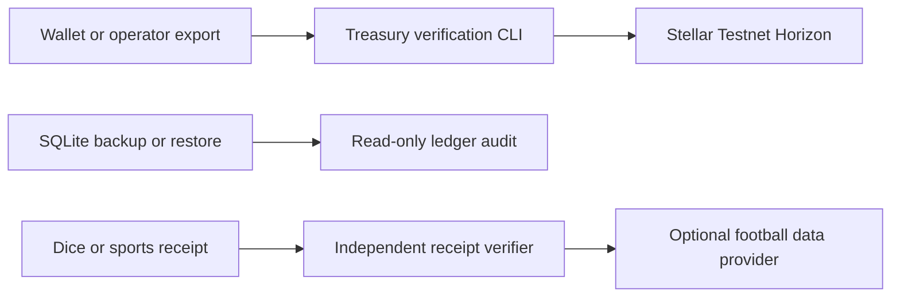

# RemitPulse Stellar Testnet treasury

This repository contains read-only tools for verifying native XLM wallet activity. The casino and sportsbook settle simulated balances in the [backend ledger](https://github.com/Remitpulse/backend/tree/stellar-casino-milestone). Native deposits and withdrawals use Stellar Classic payment operations.

## What this toolkit verifies



| Command | Input | Checks |
| --- | --- | --- |
| `treasury -- balance` | Treasury G-address | Native Testnet XLM balance |
| `treasury -- status` | Transaction hash | Confirmed, failed, or absent Horizon receipt |
| `treasury -- receipt`, `receipt-file` | Hash or operator transfer record, plus treasury address | One successful native XLM payment and optional recorded details |
| `treasury -- reconcile`, `reconcile-file` | Treasury and liability amount, or operator summary JSON | Exact difference in stroops |
| `treasury -- envelope` | Local signed envelope and recorded hash | Testnet hash, expiry, and signature count |
| `treasury:audit` | One SQLite file or a backup and restored copy | Ledger integrity, balance consistency, transfer records, and pending signatures |
| `fairness:verify` | Dice receipt or sports ticket JSON | Dice commitment and payout, or sports outcome and payout checks |

This checkout uses Stellar Classic payment records and local verification tools. The application backend handles signing, submission, and ledger changes.

## Install and test

Use Node.js 24.

```sh
npm ci
npm test
```

## Run the treasury CLI on its own

The treasury commands run from this checkout with Node.js and the dependencies
installed above. They have no runtime dependency on the RemitPulse frontend
or backend. To verify a synthetic reconciliation snapshot offline, run:

```sh
npm run treasury -- reconcile-file examples/testnet-reconciliation.json
```

The result reports `25000000` stroops in liabilities and
`treasuryCompared: true`. The sample contains illustrative amounts.
For a native XLM receipt, use the command below with a public Testnet
transaction hash and one of its payment addresses.

See [CONTRIBUTING.md](CONTRIBUTING.md) for setup and pull request guidance.

## Verify treasury activity

Run `npm run treasury -- balance <treasury G-address>` to read the treasury balance. Run `npm run treasury -- receipt <transaction hash> <treasury G-address>` to verify a wallet payment.

The receipt command requires a successful transaction with one native XLM payment involving the treasury. It reports the transaction hash, ledger, payment direction, exact XLM and integer stroops. The endpoint is fixed to Stellar Testnet. Use public addresses and transaction hashes. Keep signing secrets in the backend configuration.

## Verify a Dice receipt

Before wagering, expand **Pre-wager Dice proof** and select **Show next roll
commitment**. Save the 64-character value. After the roll, open Activity,
expand **Dice proof**, and select **Download receipt** under **Proof data**.
To verify the file offline, run:

```sh
npm run fairness:verify -- dice-receipt.json
```

The verifier recomputes the commitment from the revealed server seed, derives
the roll from both seeds, and calculates the payout using integer stroops.
To check that the commitment was present before the wager, compare the receipt
commitment with the value captured before submitting the client seed. Pass that
value as a second argument to make the command check it. The Activity proof
can also compare the saved commitment directly in the browser.

### Check an operator transfer record

Download a pending deposit or withdrawal record in the operator dashboard.
Check it against the Testnet treasury address configured for that deployment.

```sh
npm run treasury -- receipt-file testnet-transfer.json G_TREASURY_ADDRESS
```

The check requires one successful native XLM payment in the recorded direction,
to or from the recorded wallet, for the exact number of stroops. A transaction
that has not appeared on Horizon cannot be verified by this command.

### Compare a backup with a restored ledger

After restoring a backend snapshot to an isolated directory, run the read-only
audit against both files with Node 24.

```sh
npm run treasury:audit -- /secure-backups/source.sqlite /secure-backups/restore-drill/ledger.sqlite
```

The command checks SQLite integrity, individual Testnet balances, and pending
transfer hashes, owners, amounts, and signed envelopes. It checks pending
envelopes for a valid signature from the transaction source and a single
native XLM payment matching the amount and player wallet. It also reconciles
each Testnet balance against
credited deposits, withdrawal reservations, and released reserves. It prints
aggregate liability totals and returns a failure status on a mismatch. Omitting the second path reports a single
snapshot. Compare the backup and restored copy from the same cutoff.

The audit rejects deposits marked both failed and credited, signed
envelopes without deposit records, and reservations without withdrawals.
A closed withdrawal must have exactly one terminal entry. Confirmation
records zero stroops because the funds were reserved earlier. A failed
withdrawal must return exactly the amount originally reserved.

### Interpret pending transfer status

```sh
npm run treasury -- status TRANSACTION_HASH
```

- `confirmed` means Horizon recorded the transaction as successful. Match the
  direction, counterparty, and exact amount with `receipt-file` before
  reconciling the operator queue.
- `failed` means Horizon recorded an unsuccessful transaction. The operator
  can close a failed deposit without credit or return a failed withdrawal's
  reserve.
- `not-found` means Horizon has no record for that hash. Leave the transfer
  pending while checking its validity window and the network. This status alone
  is insufficient to release a reserve.

### Check a settled sports ticket

```sh
npm run fairness:verify -- --sports sports-ticket.json
```

The check recalculates the simulated XLM payout from the quoted odds, stake and
ticket status. Independently compare the ticket status with the match result.

With a football-data.org token set in `CASINO_FOOTBALL_DATA_TOKEN`, compare
a provider football ticket with the provider's current regulation result:

```sh
npm run fairness:verify -- --football-source sports-ticket.json
```

This mode queries the match by ID. A provider correction may cause an older
ticket to differ from the current score.

### Inspect a stored envelope offline

Run the envelope check on the host that holds the restricted recovery files:

```sh
npm run treasury -- envelope /secure-recovery/transfer.xdr TRANSACTION_HASH
```

It verifies that the envelope hashes to the recorded transaction on Testnet
and prints its deadline and signature count. The command does not submit the
envelope, and the signature count does not establish that the signatures are
valid.

### Verify a downloaded reconciliation summary

```sh
npm run treasury -- reconcile-file testnet-reconciliation.json
```

This offline check recomputes liabilities and the recorded treasury
difference in integer stroops. If Horizon was unavailable, the result reports
that no treasury comparison could be made. Pass an optional SQLite snapshot
from the same cutoff to compare its available, reserved, and liability totals
with the summary.
